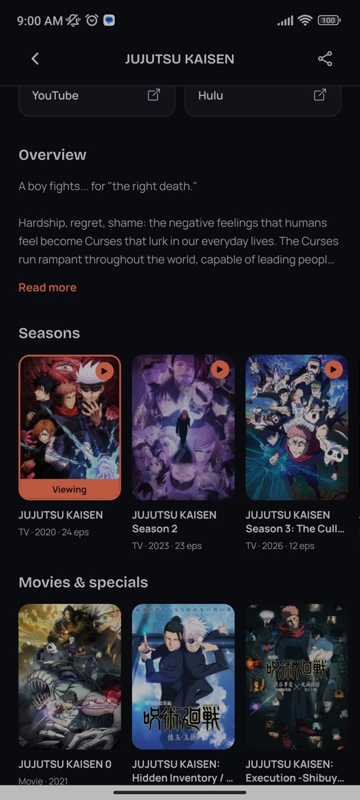
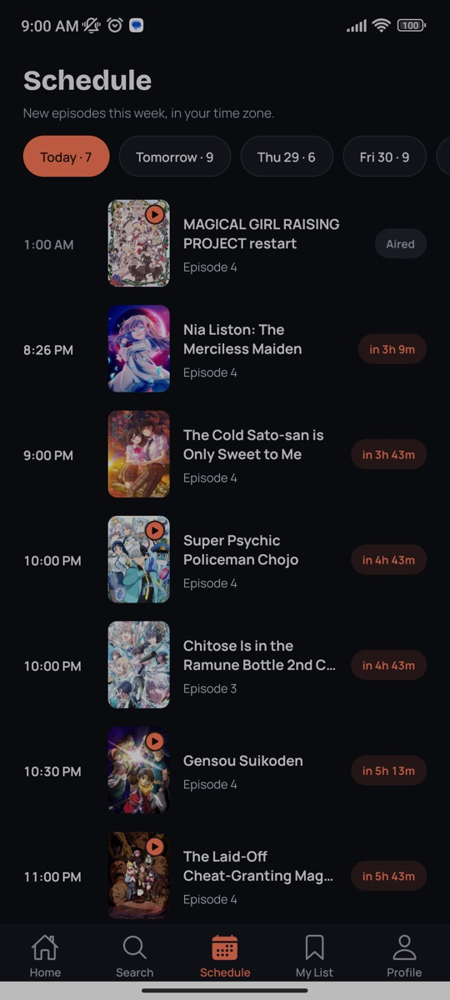
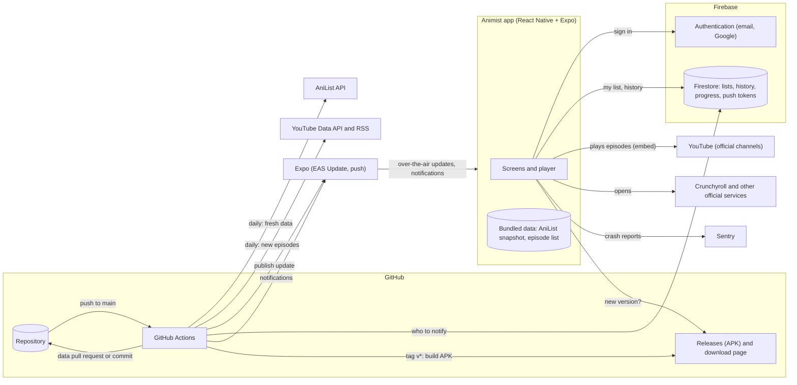

# Animist

[](https://github.com/Fnyz/Animist/actions/workflows/ci.yml)
[](https://github.com/Fnyz/Animist/releases/latest)

> An anime discovery and streaming app for Android, built with React Native (Expo) and Firebase.
> Every episode comes from a legal source.

Browse trending and airing anime, watch thousands of free episodes from official YouTube channels inside the app, pick up exactly where you left off, and keep a watchlist synced to your account.

**[Download the APK (QR code) →](https://fnyz.github.io/Animist/)**

---

## Screenshots

| Home | Details | Seasons |
|:---:|:---:|:---:|
|  |  |  |
| **Episodes** | **Player** | **Schedule** |
|  |  |  |
| **Continue watching** | **Browse by genre** | **Search** |
|  |  |  |
| **History** | | |
|  | | |

**Fullscreen player**


---

## Features

**Watch**
- ▶️ **Free episodes inside the app** from official YouTube channels, with the app's own player: play/pause, ⟲10 / ⟳10 skip, a draggable seek bar, mute, a quality picker and true 16:9 fullscreen with swipes for picture brightness (left) and volume (right)
- 🎞️ **Full movies** too, when an official channel uploads a whole film for free
- ⏯️ **Resume where you left off** on any device you sign in to, with a "Start over" option
- ⏭️ **Up next countdown** at the end of each episode, and fullscreen carries on into the next one
- 🔁 **Automatic backups**: if YouTube blocks a video in your country, the player switches to the same episode from another official channel
- 🔗 **Official links** (such as Crunchyroll) for episodes that aren't free on YouTube

**Discover**
- 🏠 **Home feed**: full-width trending banners that play muted trailer clips, Continue watching, Free to watch, new episodes, airing this season, all-time popular and top movies
- 📅 **Schedule**: what airs each day this week in your time zone, with countdowns
- 🧩 **Seasons**: every season of an anime in release order, plus its movies and specials
- 🔍 **Search all of AniList** as you type, with **filters** (format, season, year, free to watch only), and **browse by genre**
- 📄 **Details** for every anime: synopsis, genres, score, trailer, seasons and where to watch it officially
- 🎬 **Trailers** play inside the app
- 🔗 **Share links** that open the anime in Animist, or a page with the download when it isn't installed

**Your account**
- 👀 **No account needed** to browse and watch; signing in keeps your list, history and progress
- 🔐 **Continue with Google**, or email sign-up with verification, password reset and password change
- 📋 **My List** with statuses (Watching, Plan to watch, Completed, Dropped) that update as you watch, and **watch history** with progress bars, synced with Firestore
- 📥 **Import from AniList**: bring a public AniList list into My List with its statuses
- 📊 **Your stats**: episodes and hours watched, completed anime and favorite genres
- 🔔 **New-episode notifications** for anime on your list
- 👤 Profile with avatars, and **Delete account** that removes everything you stored

**Always up to date**
- 📦 New episodes and fixes arrive **over the air**, without reinstalling; an in-app prompt announces new versions
- ⬇️ The **episode list and AniList data download by themselves** from the daily update (no data used when nothing changed), so they reach older app versions too; anime pages also refresh live from AniList
- 📶 Trailer clips on Home play on **Wi-Fi only** by default (or always, or never)
- 📶 Offline banner, a player that restarts when the connection is back, and crash reporting with Sentry

---

## How episodes work

Animist does not host, download or scrape video. For each episode it picks the best legal source:

| If the episode is… | Animist shows… |
|---|---|
| Uploaded by an official YouTube channel with English subtitles or an English dub | The episode, playing inside the app |
| On an official streaming service listed by AniList | A link that opens that service (for example Crunchyroll) |
| Neither | "Not available yet", plus the anime's official "Where to watch" links |

The official channels are **Muse Asia, Muse Philippines, Ani-One Philippines, GUNDAM CHANNEL INTL, BEYBLADE and Cardfight!! Vanguard**. One anime can mix channels: when one channel is missing an episode, another fills the gap.

The episode list is built ahead of time by [`scripts/find-episodes.js`](scripts/find-episodes.js), which reads the channels' playlists with the YouTube Data API and matches them to AniList by exact title and season. The app only ships the result ([`data/episodes.json`](data/episodes.json)); the API key never ships in the app.

### New episodes automatically

A GitHub Actions workflow ([`episodes.yml`](.github/workflows/episodes.yml)) keeps the list fresh:

1. **Every day at about 06:00 Philippine time** it refreshes the AniList data behind Home (trending, airing, new episodes, the schedule) and each anime's seasons ([`scripts/seasons.js`](scripts/seasons.js)), and reads each channel's RSS feed ([`scripts/check-feeds.js`](scripts/check-feeds.js)). Both are free and use no YouTube quota.
2. **Only when there are new episodes**, it runs a quick search, about 5 minutes. It skips everything already in the app: known videos keep their saved details, and AniList is only searched for playlists it hasn't seen ([`data/finderCache.json`](data/finderCache.json) remembers earlier lookups).
3. **On Sundays** it runs the full search, which re-checks every video, in case one was removed or blocked.
   It also looks through every upload on the channels for **full movies** (a single video of 45 minutes or more whose title matches an AniList movie); quick runs only check the newest uploads.
5. **Every day it also searches all of YouTube for 30 movies** ([`scripts/search-movies.js`](scripts/search-movies.js), about 3,000 quota units), most popular first, round and round. Only uploads from the official channels in [`scripts/channels.js`](scripts/channels.js) go into the app. Full uploads from other channels with 10,000+ subscribers are listed under **Channels to review** in the pull request: add a channel to `channels.js` only if it's an official licensor (most aren't). Progress and finds are kept in [`data/movieSearch.json`](data/movieSearch.json).
4. The result arrives as a **pull request** listing the new episodes. Merging it publishes an over-the-air update, so phones get the episodes the next time the app opens.

You can also run it by hand: **Actions → Refresh episodes → Run workflow**, then choose:
- **mode**: `quick` or `full`
- **delivery**: `pull-request` (you review and merge) or `commit` (straight to `main`, then published to phones)

To make the daily run commit directly instead of opening pull requests, set the repository variable `EPISODES_DELIVERY` to `commit` (Settings → Secrets and variables → Actions → Variables).

If a run finds over 10% fewer episodes than before, it keeps the old list. That usually means a YouTube or AniList problem, not real removals.

---

## Architecture



- **The app** ships with its data (AniList details and the official episode list), so it opens instantly and works offline. Videos stream from YouTube's own player.
- **Firebase** holds only what's personal: accounts, lists, history, progress and phones' notification addresses. Rules let each person read and change only their own data.
- **GitHub Actions** keeps the data fresh every day, publishes JavaScript updates to installed apps through Expo, sends new-episode notifications, and builds the APK for releases.

---

## Tech stack

| Layer | Technology |
|---|---|
| App | React Native 0.88, React 19, Expo SDK 58 |
| Navigation | React Navigation 7 (native stack and bottom tabs) |
| UI | expo-image, expo-linear-gradient, Reanimated, Bricolage Grotesque and Manrope fonts |
| Player | YouTube embed in `react-native-webview`, with custom controls and `expo-screen-orientation` for fullscreen |
| Anime data | [AniList GraphQL API](https://docs.anilist.co) (bundled snapshot, see below) |
| Episodes | YouTube Data API v3, at build time only |
| Backend | Firebase Authentication (email, Google) and Cloud Firestore |
| Notifications | expo-notifications and Expo's push service; sent by a script in the update workflow |
| Builds and updates | EAS Build (APK), EAS Update (over-the-air updates) |
| CI/CD | GitHub Actions, CodeQL, Dependabot, Gitleaks, audit-ci |
| Tests | Jest |

The app currently reads AniList data from a saved snapshot ([`data/animeSnapshot.json`](data/animeSnapshot.json), refreshed daily by the episode workflow with `scripts/snapshot-anime.js`), so it works offline and loads instantly. Setting `USE_STATIC_DATA = false` in [`api.js`](api.js) switches to live AniList requests.

---

## Install the app

**[Download page with QR code →](https://fnyz.github.io/Animist/)**

Scan the QR code with your Android phone, or download `animist.apk` from the [latest release](https://github.com/Fnyz/Animist/releases/latest) and open it. Android asks you to allow installs from your browser the first time.

---

## CI/CD

| Trigger | Workflow | What it does |
|---|---|---|
| Every push and pull request | `ci.yml` | **Lint** (ESLint, zero warnings) and **unit tests** (Jest) · **build check** (`expo-doctor`, Expo package versions, Android bundle) · **security** (dependency vulnerabilities with `audit-ci`, secret scanning with Gitleaks) |
| Push to `main`, pull requests, weekly | `codeql.yml` | GitHub CodeQL scans the code for security bugs |
| Weekly | `dependabot.yml` | Opens pull requests for dependency updates and security fixes |
| Push to `main` | `update.yml` | Checks installed apps can run the update (no native changes since the release), publishes it with EAS Update, then sends new-episode notifications |
| By hand, any branch | `test-apk.yml` | Builds a test APK without releasing it (downloadable from the run for 7 days) |
| Daily at about 06:00 (Philippines), or by hand | `episodes.yml` | Checks the official channels' RSS feeds for new episodes and, if there are any, refreshes `data/episodes.json` and the AniList data (see [New episodes automatically](#new-episodes-automatically)) |
| Tag `v*` | `release.yml` | Builds a signed APK on the GitHub runner and attaches it to a GitHub Release |

The QR code points to `releases/latest/download/animist.apk`, so it always downloads the newest build.

### Releasing

Each version is prepared on its own branch, so `main` keeps updating the current version's phones meanwhile:

1. **Branch off:** `git switch -c release/1.4.0`, bump `version` in `app.json`, and do the work (native changes included).
2. **Try it:** Actions → **Build test APK** → Run workflow on the branch, install the APK, fix and repeat.
3. **Release:** add a `## [1.4.0] - date` section to [CHANGELOG.md](CHANGELOG.md), merge the branch into `main`, then tag and push:
   ```bash
   git tag v1.4.0
   git push origin v1.4.0
   ```

The `Release APK` workflow checks that the tag matches `app.json`, builds the APK, and publishes a GitHub Release with that version's notes from the changelog.

**When a new APK is needed:** pushes to `main` reach installed apps as over-the-air updates, which only carry JavaScript. If you add or upgrade a package with native code, or change `plugins`/`android` in `app.json`, the installed APKs can't run the update, so the `OTA update` workflow refuses it ([`scripts/check-native-changes.js`](scripts/check-native-changes.js)). Bump the version and release a new APK instead. Installed apps then show an "update available" prompt.

<details>
<summary>One-time setup for a fork</summary>

1. Create a free account at [expo.dev](https://expo.dev), then run `npx eas-cli login` and `npx eas-cli init` in the project. This links the project and adds its ID to `app.json`.
2. Run `npx eas-cli credentials -p android`, choose the **preview** profile, and let EAS generate the Android keystore. Every APK is signed with it.
3. Run `npx eas-cli update:configure` to turn on over-the-air updates.
4. Create an access token at expo.dev → Account settings → Access tokens, and add it on GitHub as the repository secret `EXPO_TOKEN` (Settings → Secrets and variables → Actions).
5. Turn on GitHub Pages: Settings → Pages → Deploy from a branch → `main` / `docs`.
6. For daily episode updates: add your YouTube Data API key as the repository secret `YOUTUBE_API_KEY`, and allow GitHub Actions to open pull requests (Settings → Actions → General → Workflow permissions → **Allow GitHub Actions to create and approve pull requests**).
7. For Google sign-in: enable the Google provider in Firebase Authentication, add the Android app (`com.fnyz.animist`) with the EAS keystore's SHA-1 fingerprint, and put its `google-services.json` in the project root. Its "web client" ID goes in `app.json` → `extra.googleWebClientId`.
8. For notifications: upload a Firebase service account key to Expo (`npx eas-cli credentials -p android` → Push Notifications (FCM V1)), add a key that can only use Firestore (role *Cloud Datastore User*) as the repository secret `FIREBASE_SERVICE_ACCOUNT`, and publish [`firestore.rules`](firestore.rules).

</details>

---

## Getting started

### Prerequisites
- Node.js 20+
- An Android phone with Expo Go, or an Android emulator
- A Firebase project with Authentication (email/password) and Firestore enabled

### Run it

```bash
git clone https://github.com/Fnyz/Animist.git
cd Animist
npm install
npx expo start            # then scan the QR code with Expo Go
```

To use your own Firebase project, replace the config values in [`firebase.js`](firebase.js) and deploy the rules in [`firestore.rules`](firestore.rules).

### Checks

```bash
npm run lint   # ESLint, same as CI
npm test       # Jest unit tests
```

### Refresh the episode list by hand (optional)

Add a YouTube Data API key to `.env` (see [`.env.example`](.env.example)), then run:

```bash
node scripts/check-feeds.js            # what's new on the channels (free, no key needed)
node scripts/find-episodes.js --quick  # only what's new: new playlists and new videos (~5 min)
node scripts/find-episodes.js          # full search: re-checks everything (15–40 min)
node scripts/seasons.js                # seasons, movies and specials of each anime (free, ~1 min)
```

A run uses about 1,500–2,500 of the free 10,000 daily quota units. The full search is slower because AniList allows about 30 requests a minute.

### Update the screenshots

Connect an Android phone with USB debugging (or start an emulator), open the app, and run [`scripts/capture-screenshots.sh`](scripts/capture-screenshots.sh). It walks you through each screen and saves them to `docs/screenshots/`.

---

## Project structure

```
Animist/
├── App.js                  # Navigation (tabs and stacks), fonts, auth gate
├── context.js              # Signed-in user, watchlist, history and watch progress (Firestore)
├── api.js                  # AniList data and episode sources for every screen
├── progress.js             # Watch progress helpers (resume point, "12:34 left")
├── firebase.js             # Firebase setup
├── googleAuth.js           # "Continue with Google"
├── notifications.js        # New-episode notifications on the phone
├── sentry.js               # Crash reporting
├── connectivity.js         # Online/offline detection
├── appVersion.js           # "A new version is out" check
├── theme.js                # Colors, fonts and spacing
├── screens/                # Home, Search, List, Details, Watch, My List, Profile, Auth, …
├── components/
│   ├── VideoPlayer.js      # Player controls, fullscreen, up next, backup videos
│   ├── YouTubeView.js      # The YouTube embed inside a WebView
│   ├── fullscreenBox.js    # Exact 16:9 fullscreen size on any screen shape
│   ├── HeroCarousel.js     # Trending carousel on Home
│   ├── ContinueRow.js      # Continue watching row on Home
│   ├── UpdateNotice.js     # New-version prompt
│   ├── NotificationBridge.js # Opens the anime a notification is about
│   └── ui.js               # Buttons, posters, rows and other shared UI
├── data/
│   ├── animeSnapshot.json  # Saved AniList data
│   └── episodes.json       # Official YouTube episodes, matched to AniList
├── scripts/                # Episode finder, RSS check, AniList snapshot, notifications, update guard
├── __tests__/              # Jest tests
└── docs/                   # Download page (GitHub Pages) and screenshots
```

---

## Roadmap

- [x] **Clean up and upgrade**: current Expo SDK, stay signed in, stricter Firestore rules
- [x] **New design**: dark theme with coral accents and bottom tabs
- [x] **Legal data**: AniList for anime information
- [x] **Episodes**: official YouTube channels inside the app, Crunchyroll links, trailers
- [x] **Player**: custom controls, fullscreen, quality, resume, up next, backup videos
- [x] **CI/CD**: GitHub Actions, signed APK releases, QR download page, over-the-air updates
- [x] **Screenshots**
- [x] **Fresh episodes automatically**: daily RSS check, pull requests with new episodes
- [x] **Browse without an account**, Google Sign-In, new-episode notifications
- [x] **Daily AniList data** refresh (trending, airing, new episodes)
- [x] **1.4.0**: AniList list import, search filters, stats, full movies, share links, live AniList search, self-updating episode list and data, Wi-Fi-only trailer clips
- [ ] **Readable crash reports** in Sentry (source maps)
- [ ] **Later**: Google Play release, UI tests with Maestro

See [CHANGELOG.md](CHANGELOG.md) for what changed in each version.

---

## Disclaimer

Animist does not host, store or scrape any video. Anime information comes from AniList. Episodes play from official YouTube channels through YouTube's embedded player, or open on licensed services. All anime titles and artwork belong to their respective owners.

## License

This project is for educational and personal use.
