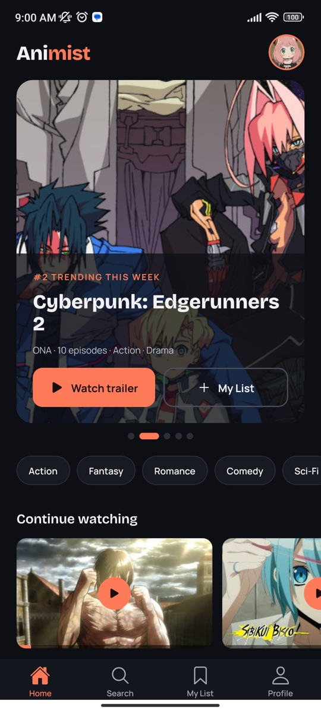
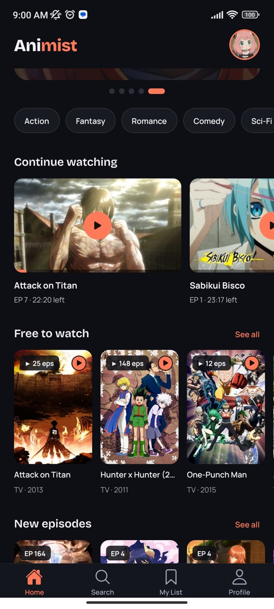
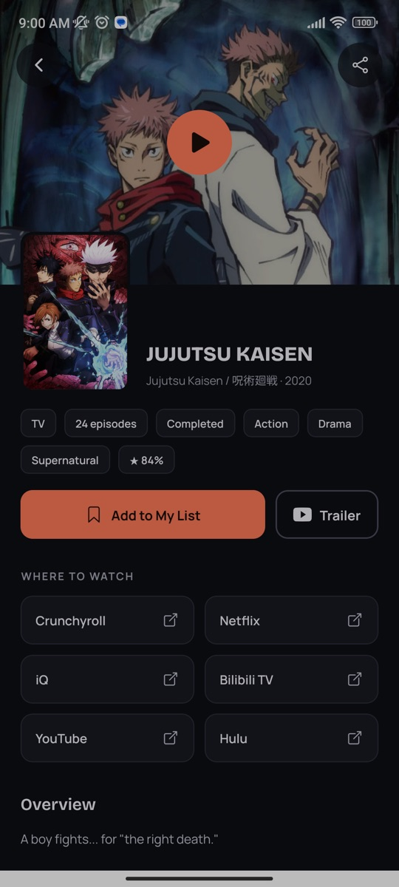
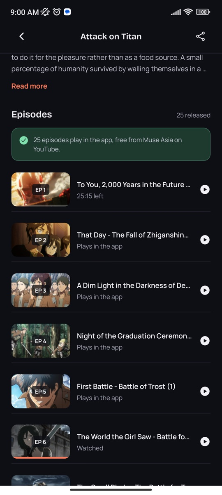
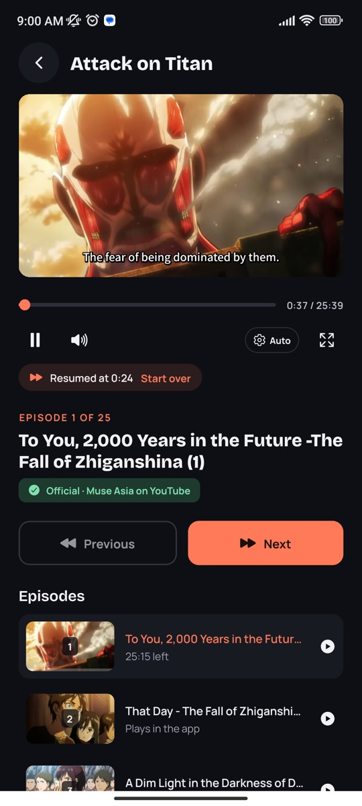
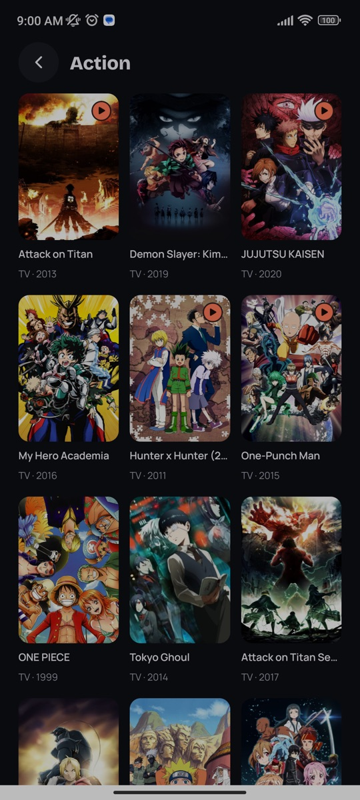
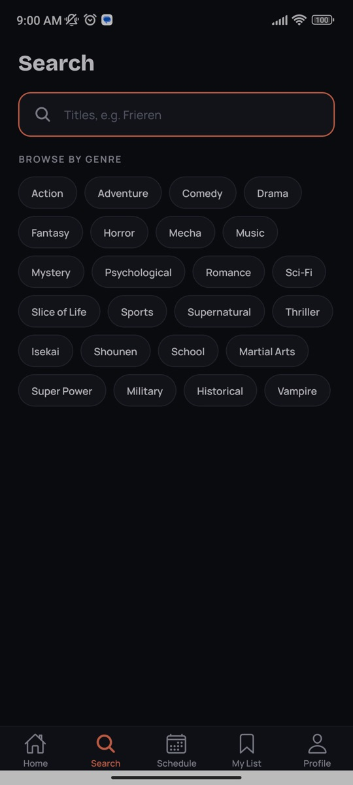
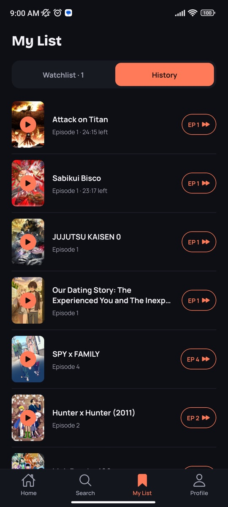
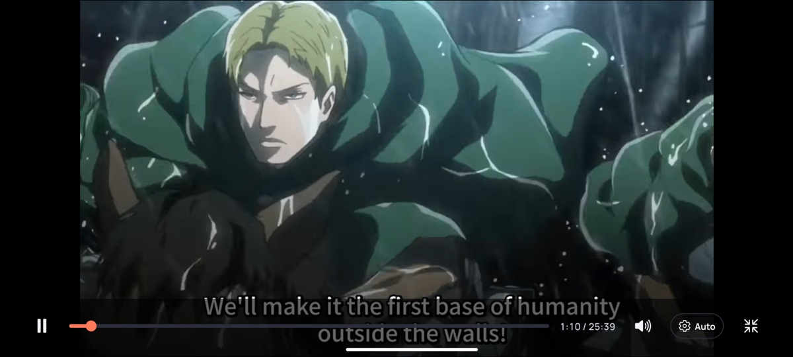

# Animist

[](https://github.com/Fnyz/Animist/actions/workflows/ci.yml)
[](https://github.com/Fnyz/Animist/releases/latest)

> An anime discovery and streaming app for Android, built with React Native (Expo) and Firebase.
> Every episode comes from a legal source.

Browse trending and airing anime, watch thousands of free episodes from official YouTube channels inside the app, pick up exactly where you left off, and keep a watchlist synced to your account.

**[Download the APK (QR code) →](https://fnyz.github.io/Animist/)**

---

## Screenshots

| Home | Continue watching | Details |
|:---:|:---:|:---:|
|  |  |  |
| **Episodes** | **Player** | **Browse by genre** |
|  |  |  |
| **Search** | **History** | |
|  |  | |

**Fullscreen player**



---

## Features

**Watch**
- ▶️ **Free episodes inside the app** from official YouTube channels, with the app's own player: play/pause, a draggable seek bar, mute, a quality picker and true 16:9 fullscreen
- ⏯️ **Resume where you left off** on any device you sign in to, with a "Start over" option
- ⏭️ **Up next countdown** at the end of each episode, and fullscreen carries on into the next one
- 🔁 **Automatic backups**: if YouTube blocks a video in your country, the player switches to the same episode from another official channel
- 🔗 **Official links** (such as Crunchyroll) for episodes that aren't free on YouTube

**Discover**
- 🏠 **Home feed**: a trending carousel, Continue watching, Free to watch, new episodes, airing this season, all-time popular and top movies
- 🔍 **Search as you type** and **browse by genre**
- 📄 **Details** for every anime: synopsis, genres, score, trailer and where to watch it officially
- 🎬 **Trailers** play inside the app

**Your account**
- 🔐 Email sign-up with verification, password reset and password change
- 📋 **Watchlist** and **watch history** with progress bars, synced with Firestore
- 👤 Profile with avatars

---

## How episodes work

Animist does not host, download or scrape video. For each episode it picks the best legal source:

| If the episode is… | Animist shows… |
|---|---|
| Uploaded by an official YouTube channel with English subtitles or an English dub | The episode, playing inside the app |
| On an official streaming service listed by AniList | A link that opens that service (for example Crunchyroll) |
| Neither | "Not available yet", plus the anime's official "Where to watch" links |

The official channels are **Muse Asia, Muse Philippines, Ani-One Philippines, GUNDAM CHANNEL INTL, BEYBLADE and Cardfight!! Vanguard**. One anime can mix channels: when one channel is missing an episode, another fills the gap.

The episode list is built ahead of time by [`scripts/find-episodes.js`](scripts/find-episodes.js), which reads the channels' playlists with the YouTube Data API and matches them to AniList by exact title and season. The app only ships the result ([`data/episodes.json`](data/episodes.json)); the API key never ships in the app.

### New episodes automatically

A GitHub Actions workflow ([`episodes.yml`](.github/workflows/episodes.yml)) keeps the list fresh:

1. **Every day at 06:00 Philippine time** it reads each channel's RSS feed ([`scripts/check-feeds.js`](scripts/check-feeds.js)). Feeds are free and use no API quota.
2. **Only when there are new episodes**, it runs a quick search, about 5 minutes. It skips everything already in the app: known videos keep their saved details, and AniList is only searched for playlists it hasn't seen ([`data/finderCache.json`](data/finderCache.json) remembers earlier lookups).
3. **On Sundays** it runs the full search, which re-checks every video, in case one was removed or blocked.
4. The result arrives as a **pull request** listing the new episodes. Merging it publishes an over-the-air update, so phones get the episodes the next time the app opens.

You can also run it by hand: **Actions → Refresh episodes → Run workflow**, then choose:
- **mode**: `quick` or `full`
- **delivery**: `pull-request` (you review and merge) or `commit` (straight to `main`, then published to phones)

To make the daily run commit directly instead of opening pull requests, set the repository variable `EPISODES_DELIVERY` to `commit` (Settings → Secrets and variables → Actions → Variables).

If a run finds over 10% fewer episodes than before, it keeps the old list. That usually means a YouTube or AniList problem, not real removals.

---

## Tech stack

| Layer | Technology |
|---|---|
| App | React Native 0.88, React 19, Expo SDK 58 |
| Navigation | React Navigation 7 (native stack and bottom tabs) |
| UI | expo-image, expo-linear-gradient, Reanimated, Bricolage Grotesque and Manrope fonts |
| Player | YouTube embed in `react-native-webview`, with custom controls and `expo-screen-orientation` for fullscreen |
| Anime data | [AniList GraphQL API](https://docs.anilist.co) (bundled snapshot, see below) |
| Episodes | YouTube Data API v3, at build time only |
| Backend | Firebase Authentication and Cloud Firestore |
| Builds and updates | EAS Build (APK), EAS Update (over-the-air updates) |
| CI/CD | GitHub Actions, CodeQL, Dependabot, Gitleaks, audit-ci |
| Tests | Jest |

The app currently reads AniList data from a saved snapshot ([`data/animeSnapshot.json`](data/animeSnapshot.json), refreshed with `scripts/snapshot-anime.js`), so it works offline and loads instantly. Setting `USE_STATIC_DATA = false` in [`api.js`](api.js) switches to live AniList requests.

---

## Install the app

**[Download page with QR code →](https://fnyz.github.io/Animist/)**

Scan the QR code with your Android phone, or download `animist.apk` from the [latest release](https://github.com/Fnyz/Animist/releases/latest) and open it. Android asks you to allow installs from your browser the first time.

---

## CI/CD

| Trigger | Workflow | What it does |
|---|---|---|
| Every push and pull request | `ci.yml` | **Lint** (ESLint, zero warnings) and **unit tests** (Jest) · **build check** (`expo-doctor`, Expo package versions, Android bundle) · **security** (dependency vulnerabilities with `audit-ci`, secret scanning with Gitleaks) |
| Push to `main`, pull requests, weekly | `codeql.yml` | GitHub CodeQL scans the code for security bugs |
| Weekly | `dependabot.yml` | Opens pull requests for dependency updates and security fixes |
| Push to `main` | `update.yml` | Publishes an over-the-air update to installed apps with EAS Update |
| Daily at 06:00 (Philippines), or by hand | `episodes.yml` | Checks the official channels' RSS feeds for new episodes and, if there are any, refreshes `data/episodes.json` (see [New episodes automatically](#new-episodes-automatically)) |
| Tag `v*` | `release.yml` | Builds a signed APK on the GitHub runner and attaches it to a GitHub Release |

The QR code points to `releases/latest/download/animist.apk`, so it always downloads the newest build.

### Releasing

1. Update `version` in `app.json` and add a `## [x.y.z] - date` section to [CHANGELOG.md](CHANGELOG.md).
2. Commit, then tag and push:
   ```bash
   git tag v1.2.0
   git push origin v1.2.0
   ```

The `Release APK` workflow checks that the tag matches `app.json`, builds the APK, and publishes a GitHub Release with that version's notes from the changelog.

**When a new APK is needed:** pushes to `main` reach installed apps as over-the-air updates, which only carry JavaScript. If you add or upgrade a package with native code, or change `plugins`/`android` in `app.json`, the installed APKs can't run the update, so the `OTA update` workflow refuses it ([`scripts/check-native-changes.js`](scripts/check-native-changes.js)). Bump the version and release a new APK instead. Installed apps then show an "update available" prompt.

<details>
<summary>One-time setup for a fork</summary>

1. Create a free account at [expo.dev](https://expo.dev), then run `npx eas-cli login` and `npx eas-cli init` in the project. This links the project and adds its ID to `app.json`.
2. Run `npx eas-cli credentials -p android`, choose the **preview** profile, and let EAS generate the Android keystore. Every APK is signed with it.
3. Run `npx eas-cli update:configure` to turn on over-the-air updates.
4. Create an access token at expo.dev → Account settings → Access tokens, and add it on GitHub as the repository secret `EXPO_TOKEN` (Settings → Secrets and variables → Actions).
5. Turn on GitHub Pages: Settings → Pages → Deploy from a branch → `main` / `docs`.
6. For daily episode updates: add your YouTube Data API key as the repository secret `YOUTUBE_API_KEY`, and allow GitHub Actions to open pull requests (Settings → Actions → General → Workflow permissions → **Allow GitHub Actions to create and approve pull requests**).

</details>

---

## Getting started

### Prerequisites
- Node.js 20+
- An Android phone with Expo Go, or an Android emulator
- A Firebase project with Authentication (email/password) and Firestore enabled

### Run it

```bash
git clone https://github.com/Fnyz/Animist.git
cd Animist
npm install
npx expo start            # then scan the QR code with Expo Go
```

To use your own Firebase project, replace the config values in [`firebase.js`](firebase.js) and deploy the rules in [`firestore.rules`](firestore.rules).

### Checks

```bash
npm run lint   # ESLint, same as CI
npm test       # Jest unit tests
```

### Refresh the episode list by hand (optional)

Add a YouTube Data API key to `.env` (see [`.env.example`](.env.example)), then run:

```bash
node scripts/check-feeds.js            # what's new on the channels (free, no key needed)
node scripts/find-episodes.js --quick  # only what's new: new playlists and new videos (~5 min)
node scripts/find-episodes.js          # full search: re-checks everything (15–40 min)
```

A run uses about 1,500–2,500 of the free 10,000 daily quota units. The full search is slower because AniList allows about 30 requests a minute.

### Update the screenshots

Connect an Android phone with USB debugging (or start an emulator), open the app, and run [`scripts/capture-screenshots.sh`](scripts/capture-screenshots.sh). It walks you through each screen and saves them to `docs/screenshots/`.

---

## Project structure

```
Animist/
├── App.js                  # Navigation (tabs and stacks), fonts, auth gate
├── context.js              # Signed-in user, watchlist, history and watch progress (Firestore)
├── api.js                  # AniList data and episode sources for every screen
├── progress.js             # Watch progress helpers (resume point, "12:34 left")
├── firebase.js             # Firebase setup
├── theme.js                # Colors, fonts and spacing
├── screens/                # Home, Search, List, Details, Watch, My List, Profile, Auth, …
├── components/
│   ├── VideoPlayer.js      # Player controls, fullscreen, up next, backup videos
│   ├── YouTubeView.js      # The YouTube embed inside a WebView
│   ├── fullscreenBox.js    # Exact 16:9 fullscreen size on any screen shape
│   ├── HeroCarousel.js     # Trending carousel on Home
│   ├── ContinueRow.js      # Continue watching row on Home
│   └── ui.js               # Buttons, posters, rows and other shared UI
├── data/
│   ├── animeSnapshot.json  # Saved AniList data
│   └── episodes.json       # Official YouTube episodes, matched to AniList
├── scripts/                # Episode finder and RSS check, AniList snapshot, screenshot capture
├── __tests__/              # Jest tests
└── docs/                   # Download page (GitHub Pages) and screenshots
```

---

## Roadmap

- [x] **Clean up and upgrade**: current Expo SDK, stay signed in, stricter Firestore rules
- [x] **New design**: dark theme with coral accents and bottom tabs
- [x] **Legal data**: AniList for anime information
- [x] **Episodes**: official YouTube channels inside the app, Crunchyroll links, trailers
- [x] **Player**: custom controls, fullscreen, quality, resume, up next, backup videos
- [x] **CI/CD**: GitHub Actions, signed APK releases, QR download page, over-the-air updates
- [x] **Screenshots**
- [x] **Fresh episodes automatically**: daily RSS check, pull requests with new episodes
- [ ] **Live AniList data** instead of the snapshot
- [ ] **Browse without an account**, Google Sign-In, new-episode notifications, AniList list import
- [ ] **UI tests** with Maestro
- [ ] **Later**: Google Play release, comment reporting and spoiler tags, in-app account deletion

See [CHANGELOG.md](CHANGELOG.md) for what changed in each version.

---

## Disclaimer

Animist does not host, store or scrape any video. Anime information comes from AniList. Episodes play from official YouTube channels through YouTube's embedded player, or open on licensed services. All anime titles and artwork belong to their respective owners.

## License

This project is for educational and personal use.
